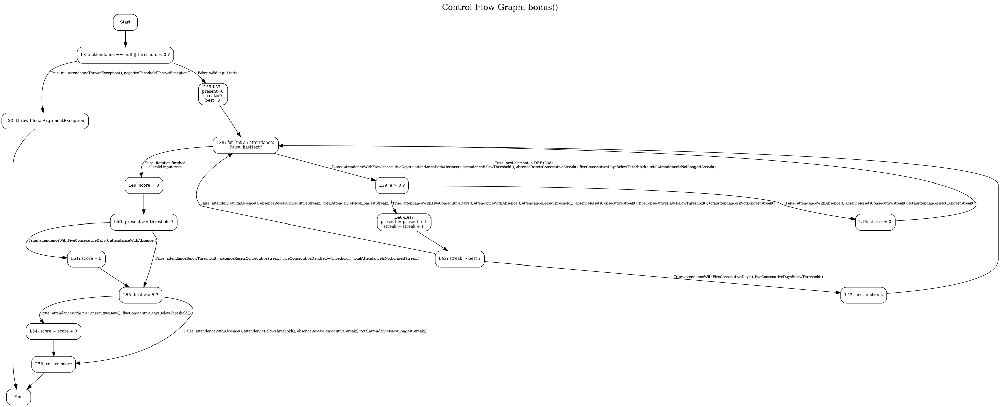

# Лаборатори №10 — Data Flow Testing

**Оюутан:**   C.Асилан
**Хичээл:** F.CSA313 — Software Quality Assurance and Testing  
**Сэдэв:** Data Flow Testing — Definition-Use Pairs

## 1. Орчны мэдээлэл

| Үзүүлэлт | Хувилбар |
|---|---|
| Operating System | Ubuntu 24.04 |
| Java Runtime | OpenJDK 21.0.13 |
| Maven | Apache Maven 3.8.7 |
| Java compiler target | Java 17 |
| JUnit Jupiter | 5.10.2 |
| JaCoCo | 0.8.12 |
| Graphviz | 2.43.0 |

## 2. Лабораторийн зорилго

Энэхүү лабораторийн ажлын зорилго нь Data Flow Testing аргыг ашиглан програмын хувьсагчдын тодорхойлолт (Definition) болон хэрэглээ (Use)-ний хамаарлыг шинжлэх явдал юм.

Энэ ажлаар:
- GCD функцийн DU хосуудыг тодорхойлсон.
- Bonus функцийн Def/Use мэдээллийг гаргасан.
- All-Defs болон All-DU-Pairs тестүүд боловсруулсан.
- JaCoCo ашиглан branch болон line coverage хэмжсэн.
- Mutation Testing ашиглан тестийн үр нөлөөг шалгасан.

## 3. A хэсэг — GCD функцийн DU шинжилгээ

GCD функц нь хоёр бүхэл тооны хамгийн их ерөнхий хуваагчийг Евклидийн алгоритмаар олно.

### 3.1 Definition болон Use

| Хувьсагч | Definition | Use |
|---|---|---|
| x | L13 (parameter), L17 | L16, L20 |
| y | L13 (parameter), L18 | L15, L16, L17 |
| tmp | L16 | L18 |

`tmp` хувьсагчийн L14 дэх зарлал нь утга оноогоогүй тул Definition гэж тооцохгүй.

### 3.2 DU хосууд

| Хувьсагч | DU хос |
|---|---|
| x | L13 → L16 |
| x | L13 → L20 |
| x | L17 → L16 |
| x | L17 → L20 |
| y | L13 → L15 |
| y | L13 → L16 |
| y | L13 → L17 |
| y | L18 → L15 |
| y | L18 → L16 |
| y | L18 → L17 |
| tmp | L16 → L18 |

### 3.3 GCD тестүүд

`GcdTest.java` файлд дараах тестүүдийг хэрэгжүүлсэн.

| Test method | Оролт | Хүлээгдэж буй үр дүн |
|---|---|---:|
| gcdWithZeroY | gcd(7, 0) | 7 |
| gcdWithTwoIterations | gcd(12, 8) | 4 |
| gcdWithZeroX | gcd(0, 5) | 5 |

Эдгээр тест нь давталт огт ажиллахгүй, олон удаа ажиллах болон эхний параметр 0 байх тохиолдлуудыг шалгана.

## 4. B хэсэг — Bonus функцийн Data Flow шинжилгээ

Bonus функц нь ирцийн мэдээлэлд үндэслэн оноо тооцно.

- Ирсэн өдрийн тоо threshold-тэй тэнцүү буюу их бол 5 оноо.
- Дараалсан ирцийн хамгийн урт цуваа 5 буюу түүнээс их бол нэмэлт 3 оноо.
- attendance null эсвэл threshold сөрөг бол IllegalArgumentException үүсгэнэ.

### 4.1 Definition болон Use хүснэгт

| Хувьсагч | Definition | Use |
|---|---|---|
| attendance | L31 | L32, L38 |
| threshold | L31 | L32, L50 |
| a | L38 | L39 |
| present | L35, L40 | L40, L50 |
| streak | L36, L41, L46 | L41, L42 |
| best | L37, L43 | L42, L53 |
| score | L49, L51, L54 | L54, L56 |

### 4.2 DU хосууд

| Хувьсагч | DU хос |
|---|---|
| attendance | L31 → L32 |
| attendance | L31 → L38 |
| threshold | L31 → L32 |
| threshold | L31 → L50 |
| a | L38 → L39 |
| present | L35 → L40 |
| present | L35 → L50 |
| present | L40 → L40 |
| present | L40 → L50 |
| streak | L36 → L41 |
| streak | L36 → L42 |
| streak | L41 → L41 |
| streak | L41 → L42 |
| streak | L46 → L41 |
| streak | L46 → L42 |
| best | L37 → L42 |
| best | L37 → L53 |
| best | L43 → L42 |
| best | L43 → L53 |
| score | L49 → L54 |
| score | L49 → L56 |
| score | L51 → L54 |
| score | L51 → L56 |
| score | L54 → L56 |

**Тайлбар:** DU хос гэдэг нь хувьсагч утга авсан Definition-ээс тухайн утгыг ашигласан Use хүртэл, замын дунд дахин Definition хийгдээгүй холбоог хэлнэ. Давталтын дараагийн давталт руу шилжих хосуудыг мөн тооцсон.

### 4.3 Control Flow Graph

Bonus функцийн Control Flow Graph зургийг Graphviz ашиглан үүсгэсэн.

CFG-ийн эх файл: `cfg-bonus.dot`

Зурагт нөхцөл шалгалтууд, давталтын шилжилт, хувьсагчийн Definition болон Use байрлалуудыг харуулсан.

### 4.4 Bonus тестүүд

`BonusTest.java` файлд нийт 8 тест хэрэгжүүлсэн.

| Test method | Шалгах нөхцөл |
|---|---|
| nullAttendanceThrowsException | null оролт |
| negativeThresholdThrowsException | Сөрөг threshold |
| attendanceWithFiveConsecutiveDays | 5 дараалсан ирц |
| attendanceWithAbsence | Таслалттай ирц |
| attendanceBelowThreshold | Threshold хүрэхгүй |
| absenceResetsConsecutiveStreak | Таслалтын дараа streak тэглэх |
| fiveConsecutiveDaysBelowThreshold | Дараалсан 5 ирц боловч threshold хүрэхгүй |
| totalAttendanceIsNotLongestStreak | Нийт ирц ба хамгийн урт цувааг ялгах |

### 4.5 All-Defs ба All-DU-Pairs

All-Defs нь хувьсагч бүрийн Definition-ээс хүрч болох Use-ийг дор хаяж нэг удаа шалгах арга юм.

All-DU-Pairs нь хувьсагчийн Definition болон Use-ийн бүх боломжит def-clear хосыг шалгах зорилготой.

Хэрэгжүүлсэн тестүүдийн үр дүнг дараах файлд хадгалсан.

- `results/mvn-verify-alldefs.txt`
- `results/jacoco-alldefs.csv`
- `results/mvn-verify-alldupairs.txt`
- `results/jacoco-alldupairs.csv`

## 5. C хэсэг — Mutation Testing

Mutation Testing ашиглан үндсэн кодод түр өөрчлөлт оруулж, тестүүд тэдгээр алдааг илрүүлж чадаж байгаа эсэхийг шалгасан.

| Mutation | Өөрчлөлт | Үр дүн |
|---|---|---|
| M1 | streak-ийн нэмэгдүүлэлтийг хассан | KILLED |
| M2 | best = streak-ийг best = present болгосон | Эхний тестүүдэд SURVIVED, шинэ тестээр KILLED |
| M3 | Ашиглагдахгүй total хувьсагч нэмсэн | Тестүүд илрүүлээгүй |

### M1

`streak = streak + 1` мөрийг хассанаар дараалсан ирцийн тооцоолол буруу болсон. Хоёр тест алдаатай болж, M1 мутаци KILLED болсон.

Үр дүн: `results/mvn-test-M1.txt`

### M2

`best = streak` мөрийг `best = present` болгон өөрчилсөн.

Эхний тестийн багц 10/10 PASS болсон тул мутаци SURVIVED.

Дараа нь `totalAttendanceIsNotLongestStreak()` тестийг нэмсэн. Энэ тест нийт ирсэн өдрийн тоо болон хамгийн урт дараалсан ирцийн цуваа ялгаатай байх нөхцөлийг шалгасан. Шинэ тест M2 мутацийг илрүүлж, хүлээгдсэн 0 онооны оронд 3 оноо гарсан тул тест унасан.

Үр дүн:
- `results/mvn-test-M2.txt`
- `results/mvn-test-M2-kill.txt`

### M3

Ашиглагдахгүй `total` хувьсагч нэмсэн. Тестүүд 11/11 PASS болсон. Энэ нь зөвхөн runtime тестээр илрүүлэх боломжгүй dead code төрлийн өөрчлөлт юм. Үүнийг static analysis эсвэл IDE-ийн unused variable шалгалтаар илрүүлэх шаардлагатай.

Үр дүн: `results/mvn-test-M3.txt`

## 6. JaCoCo Coverage

Эцсийн JaCoCo тайлан:

| Үзүүлэлт | Хамрагдсан | Нийт |
|---|---:|---:|
| Instructions | 78 | 81 |
| Branches | 16 | 16 |
| Lines | 23 | 24 |
| Complexity | 10 | 11 |
| Methods | 2 | 3 |

Branch coverage = 100%.

Line coverage = 95.83% ≈ 96%.

Нэг мөрийн coverage дутуу байгаа нь implicit constructor-той холбоотой бөгөөд лабораторийн зааварт зөвшөөрсөн тохиолдол юм.

Эцсийн тайлан: `results/jacoco-final.csv`

Эцсийн Maven шалгалт: `results/mvn-verify-final.txt`

Нийт 11 тест ажиллаж, 11 тест амжилттай PASS болсон.

## 7. Дүгнэлт

Энэхүү лабораторийн ажлаар Data Flow Testing аргыг ашиглан GCD болон Bonus функцүүдийн хувьсагчдын Definition болон Use хамаарлыг судаллаа. GCD функцийн DU хосуудыг тодорхойлж, давталтын өөр өөр нөхцөлийг шалгах тестүүд бичсэн. Bonus функцийн хувьсагчдын Definition, Use болон DU хосуудыг шинжилж, All-Defs болон All-DU-Pairs тестүүд хэрэгжүүлсэн. JaCoCo тайлангаар branch coverage 100% болсон. Mutation Testing-ийн M1 болон M2 өөрчлөлтийг тестүүд илрүүлж чадсан. M2-ийн хувьд эхний тестүүд хангалтгүй байсныг илрүүлж, нэмэлт тестээр сайжруулсан. M3 нь runtime тестээр илрэхгүй dead code болохыг ажигласан. Энэ ажлаас тестийн тоо их байх нь дангаараа хангалтгүй бөгөөд хувьсагчийн өгөгдлийн урсгал болон өөр өөр нөхцөлийг зөв хамруулах нь чухал гэдгийг ойлголоо.

## 8. AI ашигласан тухай

Лабораторийн ажлын явцад AI хэрэгслийг Data Flow Testing ойлголтыг тайлбарлуулах, DU хосуудыг шинжлэх, тестийн хувилбар боловсруулах болон тайлангийн бүтэц гаргахад туслах зорилгоор ашигласан. Код, тестүүд болон туршилтын үр дүнг локал орчинд ажиллуулж шалгасан.
